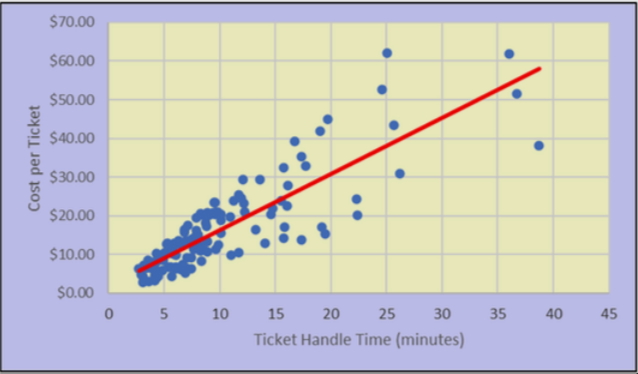
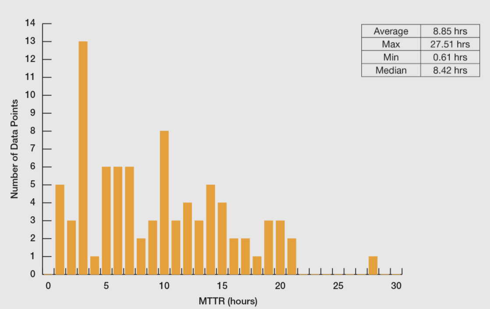

# Rapport de Projet : Eliza

**Auteurs :** Kamil AKERRAMAMOU, Laurent COSTA, Mathieu JIN

**Projet :** Conception d'un Assistant Virtuel d'Entreprise

---

## Sommaire
1. [Objectif du projet](#objectif-du-projet)
2. [Cibles et Besoin](#cibles-et-besoin)
3. [Fonctionnalités Techniques](#fonctionnalités-techniques)
4. [Modèle Économique](#modèle-économique)
5. [Étude d'Impact Éthique et Responsabilité](#étude-dimpact-éthique-et-responsabilité)
6. [Bibliographie et Sources](#bibliographie-et-sources-de-létude)

---

## Objectif du projet

Le projet Eliza
 est un chatbot pour faciliter l'intégration des nouveaux employée et fluidifier les échanges entre les employés et les services RH et informatiques. Eliza
 est connectée en temps réel aux données de l'entreprise ainsi qu'aux services locaux (horaires de transports, restauration), il centralise l'information pour simplifier et améliorer la qualité de vie au travail.

## Cibles et Besoin

* **Les nouveaux employés :**
    * **Profil :** Nouvelles recrues en phase d'intégration. Elles découvrent l'environnement de travail et les outils de l'entreprise.
    * **Besoins :** S'adapter rapidement sans avoir à demander de l'aide pour des problèmes mineurs et créer une routine de travail qui leur plaît.

* **Les employés réguliers :**
    * **Profil :** Employés déjà familiers avec l'entreprise, mais sui sont souvent confrontés à des petit problèmes qui interrompent leur journée de travail.
    * **Besoins :** Résoudre leurs problèmes quotidiens instantanément pour rester concentrés sur leurs missions, et accéder rapidement aux informations de l'entreprise.

* **Les Équipes Support (RH/IT):**
    * **Profil** Équipes chargées d'assister les employés au quotidien qui souvent surchargées par beaucoup de questions simples et répétitives
    * **Besoin** Filtrer les demandes récurrentes pour gagner du temps et se concentrer sur des dossiers complexes nécessitant une expertise technique ou humaine.

## Fonctionnalités Techniques

Eliza repose sur une architecture en trois couches. Lorsqu'un employé pose une question sur Discord, le bot analyse d'abord le message pour détecter l'intention : si la question porte sur la météo, les transports, les jours fériés ou une recherche web, il interroge l'API externe correspondante. Sinon, il utilise le système RAG (Retrieval Augmented Generation) : il recherche dans la base documentaire interne les passages les plus pertinents, puis les transmet à Ollama pour générer une réponse contextualisée.

* **Interface utilisateur :** Le chatbot est déployé sur Discord afin de s'intégrer naturellement aux outils de travail existants.
* **Moteur d'IA :** Les réponses sont générées par Ollama (modèle `phi3:mini`), qui tourne entièrement en local, sans dépendance à un service cloud externe.
* **Système RAG :** Les documents internes (FAQ RH, règles d'entreprise) sont indexés dans ChromaDB sous forme de vecteurs. À chaque question, les passages les plus proches sémantiquement sont extraits et fournis au modèle comme contexte.
* **Les API externes :**
    * `date.nager.at` — jours fériés français
    * `wttr.in` — météo en temps réel par ville
    * `ressources.data.sncf.com` — informations sur les gares et trajets SNCF
    * `DuckDuckGo Search` — recherche web générale
* **Protocole de crise :** Si un message contient des mots liés à la détresse psychologique, le bot suspend toute logique de réponse normale et redirige immédiatement vers les contacts humains appropriés.
    

## Modèle Économique
### Retour sur Investissement (ROI)
L'intégration de Eliza
 crée de la valeur à plusieurs niveaux :

1. **Gain financier :** En automatisant la résolution des requêtes récurrentes , le chatbot réduit drastiquement le volume de tickets d'assistance. Ce filtrage permet de libérer un temps précieux aux experts RH et IT, qui peuvent alors se concentrer sur des tâches importantes. Le coût humain du support interne est ainsi considérablement optimisé.
2. **Gain de temps :** Grâce à un accès instantané et autonome à l'information, les nouvelles recrues ne restent plus bloquées dans l'attente d'une réponse de leur manager ou du support. Cette fluidité accélère leur montée en compétences, leur permettant d'être pleinement opérationnelles et productives beaucoup plus rapidement.

### Performance Indicators (KPIs)

Pour mesurer le succès de notre solution, nous suivrons les indicateurs suivants :
* **Taux de déflexion :** Réduction des tickets d'assistance ouverts auprès des RH/IT.
* **Temps de résolution moyen :** Passage de 8-9 heures à quelques minutes.
* **Satisfaction Employé :** Note moyenne attribuée par les utilisateurs en fin d'interaction.
* **Taux d'adoption :** Pourcentage des employés utilisant le chatbot mensuellement.

## Étude d'Impact Éthique et Responsabilité

L'effet ELIZA désigne la tendance des utilisateurs à projeter des traits humains sur un programme informatique — à lui attribuer une compréhension, des émotions, voire une personnalité — alors qu'il ne fait que simuler une conversation. Ce biais cognitif, identifié dès 1966 par Joseph Weizenbaum, représente un risque réel : un utilisateur peut développer une relation de confiance ou de dépendance envers un outil qui n'a aucune conscience ni intention réelle.

### Transparence et Effet ELIZA
* Pour éviter toute confusion quant à la nature du chatbot, l'interface rappellera clairement qu'il s'agit d'une intelligence artificielle. Il n'a pas vocation à simuler des émotions humaines ou à remplacer le lien social.

### Confidentialité et Données
* Les requêtes des employés ne sont pas stockées de manière permanente et ne sont pas utilisées pour entraîner des modèles externes. Le modèle Ollama tourne entièrement en local, ce qui garantit qu'aucune donnée ne quitte l'infrastructure de l'entreprise.

### Gestion du Mal-être au Travail
* **Protocole d'urgence :** Si l'IA détecte des termes liés à la détresse psychologique , elle suspendra sa logique de résolution de problème.
* **Action :** Le chatbot répondra avec une formulation neutre et empathique et fournira immédiatement les contacts humains appropriés (médecine du travail, numéro d'urgence RH, représentants du personnel).

---

## Bibliographie et Sources de l'étude

**Données financières et KPIs (Support IT / RH) :**

* **Help Desk Institute (HDI) & MetricNet :** *Metric of the Month: Cost per Ticket* et *Mean Time to Resolve*. Benchmarks mondiaux sur le coût de traitement et le temps de résolution des tickets internes.
* **Zendesk :** *Support Benchmarks - AI and Ticket Deflection Best Practices*. Études sur l'impact de l'intelligence artificielle sur le taux de déflexion et la satisfaction collaborateur.

**Ressources Techniques et APIs (Open Data) :**
* **Nager.Date (`date.nager.at`) :** API Open Source publique recensant le calendrier officiel des jours fériés mondiaux. Utilisée pour répondre aux questions sur les jours fériés français. Aucune clé API requise.
* **wttr.in :** Service météorologique open source fournissant les données climatiques en temps réel (température, ressenti, humidité, description). Utilisée pour répondre aux questions météo par ville. Aucune clé API requise.
* **DuckDuckGo Search (`duckduckgo-search`) :** Bibliothèque Python permettant d'effectuer des recherches web via le moteur DuckDuckGo sans clé API. Utilisée pour les questions générales nécessitant une recherche sur internet.
* **SNCF Open Data (`ressources.data.sncf.com`) :** Portail Open Data de la SNCF fournissant les informations sur les gares et les trajets TGV Max. Utilisée pour répondre aux questions de transport ferroviaire. Aucune clé API requise.
* **ChromaDB :** Base de données vectorielle open source utilisée pour le stockage et la recherche des documents RH (système RAG).
* **Ollama (`phi3:mini`) :** Moteur d'inférence local permettant de faire tourner des modèles de langage en local. Utilisé pour générer les réponses du chatbot sans dépendance à un service cloud.

**Éthique et Psychologie :**
* **Weizenbaum, Joseph (1966) :** Travaux fondateurs sur le programme *ELIZA* et le biais psychologique d'anthropomorphisme appliqué aux machines.